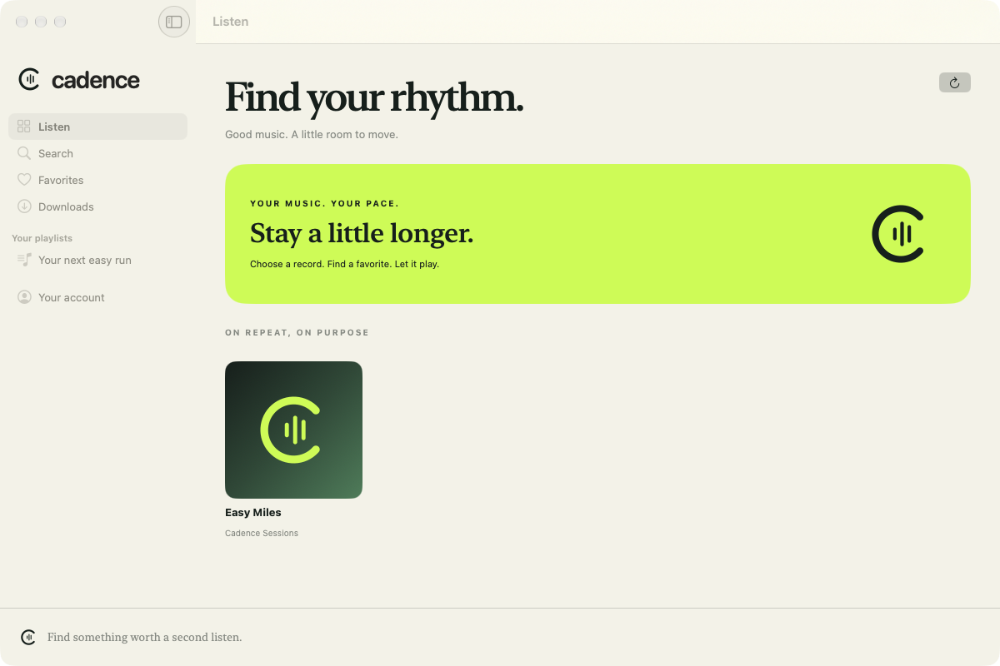
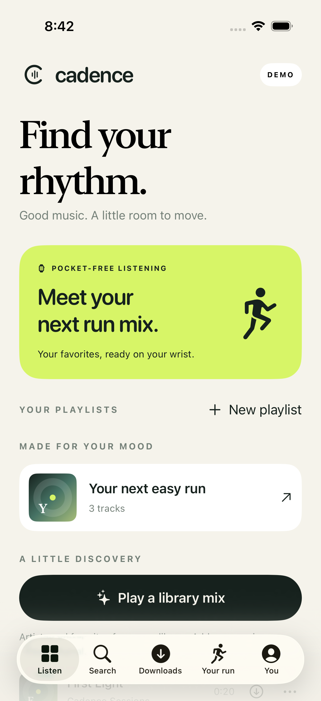
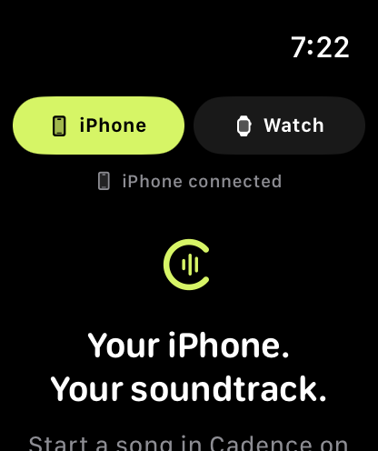

# Cadence


Your music on iPhone and Mac. Your running soundtrack on Apple Watch.

Cadence is a native SwiftUI client for a music server you control. It focuses on Aurral: browse and play your library, search a wider catalog, import Spotify playlists, and prepare offline playlists for Apple Watch.

The source is MIT licensed. There is no subscription or paid API built into Cadence. **You bring your own server and music sources.** A catalog search result is metadata, not a guarantee that full audio is available. Cadence does not provide a free Spotify catalog, hosted accounts or a music service.



<p>
  
  
</p>

*Early demo/simulator screenshots; navigation has evolved. Watch imagery does not establish physical-device acceptance.*

**Source release: 0.7.1 (17).** Server URL starts blank on iPhone and Mac. Public prebuilt apps are not available yet; the Mac notarization and physical Watch acceptance requirements are described below.

[Report a bug](https://github.com/bahachammakhi/cadence-music/issues/new/choose) · [Report a vulnerability privately](https://github.com/bahachammakhi/cadence-music/security/advisories/new)

## Try it

Build and run the **CadenceMac** scheme, then select **Explore demo**. No account, server, signing credentials or third-party music is needed for the demo's three original instrumental clips.

```sh
git clone https://github.com/bahachammakhi/cadence-music.git
cd cadence-music
brew install xcodegen
xcodegen generate
xcodebuild -project Cadence.xcodeproj -scheme CadenceMac \
  -destination 'generic/platform=macOS' -derivedDataPath .build/Mac \
  CODE_SIGNING_ALLOWED=NO build
open .build/Mac/Build/Products/Debug/Cadence.app
```

A Mac with full Xcode selected is required; Command Line Tools alone are insufficient. This unsigned build is for local development. See [building](docs/BUILDING.md) for iPhone/Watch, simulator tests and signing a fork.

For your own library, enter your **HTTPS Aurral URL, username and password** at sign-in. No server address or shared credentials are supplied. If the server is private to Tailscale, connect that device to your tailnet first. [Setup and first listen](docs/SETUP.md).

## Features

- Native iPhone, macOS and companion Apple Watch apps; original cream, ink and lime interface.
- **All music** song/artist/album metadata search, plus paged **My library** search.
- Album and song playback, queue edits, shuffle, repeat-one/all, resume, next-item preparation and bounded playback retry.
- Favorites, editable server playlists and Spotify playlist import with visible preparation progress.
- Account-scoped preparation journal for missing audio; accepted jobs run on Aurral. Uncertain requests are checked before retrying.
- Discover feeds, recently played, artist follows and local listening-based library mixes.
- iPhone/Mac downloads, system Now Playing and media controls; Space toggles Mac playback outside text fields and dialogs.
- Private iPhone/Mac queue handoff and Watch remote control over Tailscale.
- Up to 10 offline Watch playlists, 100 tracks each, with verified transfer receipts and shared-file reuse.

## Compatibility and limits

| Area | Current scope |
|---|---|
| Platforms | iOS 18+, watchOS 10+, macOS 14+; Mac Apple Silicon and Intel targets |
| Server | Tested with **Aurral 2.12.0, native API v1**, plus its Subsonic endpoints |
| Newer Aurral | Native API v2 is unvalidated; Discover currently requires v1 and may refuse newer servers |
| Other Subsonic servers | Basic routes may work, but full compatibility is not claimed |
| Global metadata | Apple public Search API, US catalog, up to 200 results per lookup/search |
| Full audio | Your Aurral library/sources; preparation can take time, require review or fail |
| Spotify | Playlist metadata/import through Aurral; not Spotify audio streaming; server-side Spotify connection may be required |
| Handoff | One Mac and paired iPhone; receiving/controlling iPhone must be foreground; no remote wake |
| Watch | Offline design implemented; physical background/Bluetooth/phone-off run acceptance remains pending |
| Recommendations | Aurral Discover plus local library ranking; no cloud-synced listening profile |
| Distribution | Development/private beta; no public TestFlight link or notarized public Mac installer |

Free, instant, reliable access to every mainstream recording is not something this client can supply. Its license covers the code and original bundled assets, not rights to recordings or external services.

## Documentation

- [Setup, playback and Spotify imports](docs/SETUP.md)
- [Build and test from source](docs/BUILDING.md)
- [Product scope and roadmap](docs/PRODUCT.md)
- [Listening, preparation and Watch playlists](docs/LISTENING-AND-WATCH.md)
- [Private Mac control and handoff](docs/MAC-CONTROL.md)
- [Architecture](docs/ARCHITECTURE.md) · [Privacy](docs/PRIVACY.md)
- [Testing and known verification gaps](docs/QA.md)
- [Release process](docs/RELEASE.md) · [Changelog](CHANGELOG.md)
- [Contributing](CONTRIBUTING.md) · [Security](SECURITY.md) · [Asset notices](THIRD_PARTY_NOTICES.md)
- [Public-release readiness](docs/OPEN-SOURCE-READINESS.md)

## Development

```sh
swift test --package-path Packages/CadenceCore
python3 -m unittest discover -s Scripts/tests -v
```

`project.yml` is the XcodeGen source of truth. `Packages/CadenceCore` contains shared models, network contracts, queue/storage logic and fixture tests. `Shared` holds app-level playback, discovery and preparation. `Apps` contains each platform's views and integration. No third-party Swift packages are required.

Contributions are welcome under [MIT](LICENSE). This is an early project; please report reproducible problems and distinguish simulator results from physical-device tests.
